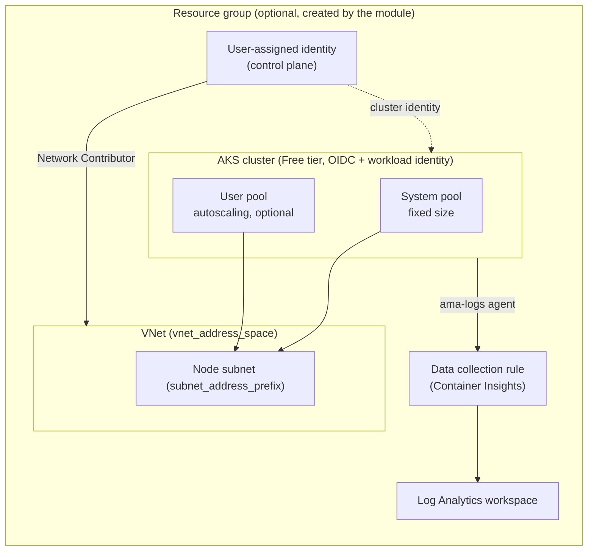

# terraform-azure-aks-lab

A Terraform module and example that stand up a small, observable AKS cluster for experiments.

> Lab project: a clean-room reference implementation of a pattern I use at work. It contains no employer code or data.

## The problem

Throwaway Kubernetes clusters tend to be built by hand from the portal or a long `az aks create` line. They end up
without monitoring (so the experiment you ran leaves no evidence), on a default network you cannot reason about, with
auto-upgrades happening whenever Azure chooses, and with nobody sure what to delete afterwards. This module makes the
lab cluster reproducible: one `apply` gives you a cluster with its own VNet, Container Insights already wired to a Log
Analytics workspace, a fixed maintenance window, and tags that say what it is; one `destroy` removes all of it.

## Architecture



## Quick start

Prerequisites: Terraform >= 1.5, Azure CLI logged in (`az login`), and rights to create role assignments in the target
subscription (Owner, or Contributor plus User Access Administrator).

```bash
cd examples/basic
export ARM_SUBSCRIPTION_ID="$(az account show --query id -o tsv)"

terraform init
terraform plan  -var-file=example.tfvars -out=tfplan
terraform apply tfplan

# Connect
eval "$(terraform output -raw get_credentials)"
kubectl get nodes

# Tear down when finished
terraform destroy -var-file=example.tfvars
```

Copy `example.tfvars` to your own file (for example `lab.tfvars`, which `.gitignore` excludes) before changing it.

## How it works

- **Resource group**: created when `create_resource_group = true`, otherwise the module deploys into an existing one.
- **Network**: one VNet and one node subnet. `network_plugin = "azure"` gives pods VNet IPs from the node subnet
  (size it accordingly); `"kubenet"` gives pods addresses from `pod_cidr` behind node NAT and needs a much smaller subnet.
- **Identity**: the control plane uses a user-assigned managed identity that is granted Network Contributor on the
  VNet before the cluster is created, so load balancers and the kubenet route table can be attached to the subnet.
  OIDC issuer and workload identity are enabled so pods can use federated credentials instead of secrets.
- **Node pools**: a fixed-size system pool, plus an optional autoscaling user pool. When the user pool is enabled the
  system pool is restricted to critical add-ons, so workloads land on the user pool.
- **Observability**: Container Insights uses managed-identity auth. Terraform creates the data collection rule and
  associates it with the cluster (the portal and CLI do this implicitly), and logs land in the Log Analytics workspace.
- **Upgrades**: Kubernetes patch upgrades and node OS image upgrades are automatic, both inside one weekly
  maintenance window.
- **Authorization**: plain Kubernetes RBAC by default; set `azure_rbac_enabled = true` to use Microsoft Entra ID and
  Azure RBAC, with optional admin groups.
- **Tags**: `managed-by = terraform` and `purpose = lab` on every resource, merged with your own `tags`.

## Inputs (`modules/aks`)

| Name | Type | Default | Description |
|------|------|---------|-------------|
| `name` | string | required | Base name, 3-40 chars of `[a-z0-9-]`. Used for resource names and the DNS prefix. |
| `location` | string | required | Azure region, e.g. `westeurope`. |
| `resource_group_name` | string | required | Resource group to create or use. |
| `create_resource_group` | bool | `true` | Create the resource group. |
| `kubernetes_version` | string | `null` | e.g. `1.33`; `null` uses the AKS default. |
| `network_plugin` | string | `"azure"` | `azure` or `kubenet`. |
| `vnet_address_space` | string | `"10.240.0.0/16"` | VNet CIDR. |
| `subnet_address_prefix` | string | `"10.240.0.0/20"` | Node subnet CIDR. |
| `service_cidr` | string | `"10.0.0.0/16"` | Kubernetes service CIDR; must not overlap the VNet. |
| `dns_service_ip` | string | `"10.0.0.10"` | Cluster DNS IP inside `service_cidr`. |
| `pod_cidr` | string | `"10.244.0.0/16"` | Pod CIDR, kubenet only. |
| `system_node_pool` | object | `{vm_size = "Standard_B2s", node_count = 1, os_disk_size_gb = 64}` | System pool settings. |
| `user_node_pool` | object | `{enabled = false, vm_size = "Standard_B2s", min_count = 0, max_count = 3, os_disk_size_gb = 64}` | Optional autoscaling user pool. |
| `azure_rbac_enabled` | bool | `false` | Use Entra ID + Azure RBAC for Kubernetes. |
| `admin_group_object_ids` | list(string) | `[]` | Entra ID groups granted cluster admin (Azure RBAC only). |
| `log_retention_days` | number | `30` | Log Analytics retention, 30-730. |
| `maintenance_window` | object | `{day_of_week = "Sunday", start_time = "02:00", duration_hours = 4, utc_offset = "+00:00"}` | Weekly upgrade window. |
| `tags` | map(string) | `{}` | Extra tags. |

All inputs with a fixed format have `validation` blocks, so mistakes fail at `plan` time rather than halfway through
an apply.

## Outputs (`modules/aks`)

| Name | Description |
|------|-------------|
| `cluster_name` | AKS cluster name. |
| `cluster_id` | AKS cluster resource ID. |
| `resource_group_name` | Resource group holding the cluster. |
| `kube_config` | Raw kubeconfig (sensitive). With Azure RBAC it needs `kubelogin`. |
| `oidc_issuer_url` | OIDC issuer URL for workload identity federation. |
| `log_analytics_workspace_id` | Workspace resource ID used by Container Insights. |

The example re-exports these and adds `get_credentials`, the `az aks get-credentials` command for the cluster.

## Cost

This is meant to be cheap, not free. The control plane uses the Free tier. You pay for the node VMs (default
`Standard_B2s`, the smallest size that meets the AKS system pool minimum of 2 vCPU / 4 GiB), their managed OS disks,
the Standard load balancer and its public IP, and Log Analytics ingestion. The user pool can scale to zero
(`min_count = 0`). Check current prices for your region with the Azure pricing calculator, and run
`terraform destroy` when you are done.

## CI

`.github/workflows/ci.yml` runs `terraform fmt -check -recursive`, `terraform init -backend=false` and
`terraform validate` in `examples/basic`, and `tflint` with the `terraform` (recommended preset) and `azurerm` rulesets.
It never calls Azure.

## Limitations

- Validated with `terraform validate` and linted, but `plan`/`apply` need an Azure subscription and are not run in CI.
- Pinned to azurerm 4.x (`>= 4.0, < 5.0`); azurerm 5.x has not been tested.
- Public API server and a public Standard load balancer. No private cluster, API server IP allow-list, NAT gateway,
  network policy or Azure Firewall; add those before using the pattern for anything that is not a lab.
- `dns_service_ip` being inside `service_cidr`, and CIDRs not overlapping, are not validated; AKS rejects such
  values at apply time.
- State is local. For shared use, add a remote backend (for example an Azure Storage account) in the example.
- B-series VMs are burstable; sustained load will exhaust CPU credits. Pick a D-series size for load tests.

## License

MIT, see [LICENSE](LICENSE).
